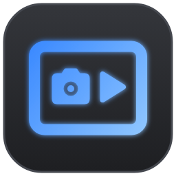
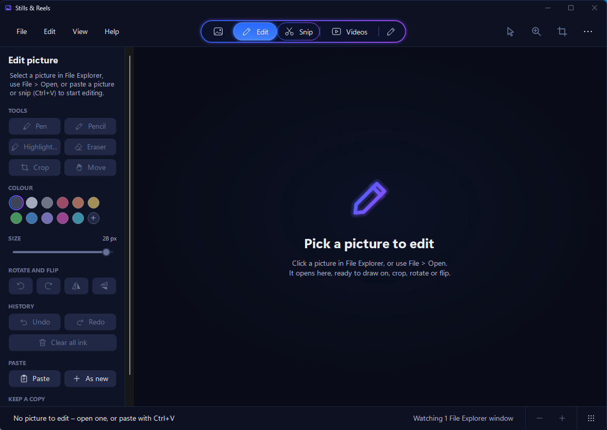

<div align="center">





# Stills & Reels

**View, edit, snip and cut your pictures and videos, all in one fast little app. Click a picture or video anywhere, in File Explorer, on the desktop or on a web page, and it's already open and ready to work on.**


[](LICENSE)

[What it is](#what-it-is) · [Hobby project](#a-hobby-project) · [Features](#features) · [Download and run](#download-and-run) · [User guide](docs/GUIDE.md) · [Privacy](#your-files-stay-yours) · [Build from source](#building-from-source) · [Licence](#licence) · [Credits](#credits-and-licences)

</div>

---

## What it is

**Stills & Reels** is a picture viewer, picture editor, video player and video editor in one lightweight Windows app. It started as a quick viewer for whatever you click in File Explorer and grew into a full editor, with everything happening inside the app. Version 3.0 rebuilt both editors: layers, selections, adjustments and many more formats for pictures, and a multi-core renderer, sound tools, new export formats and crash recovery for video.

- **One file, nothing to install.** Unzip it and double-click `StillsAndReels.exe`. It runs on any Windows 10 or 11 PC.
- **Follows your clicks.** Click a picture or video in File Explorer, on the desktop or in any Open/Save dialog and it's already showing. Click a picture on a web page or in another app and it's picked up from the screen; copy one and it's picked up at full quality.
- **Sharp video, in and out.** Screen recordings are captured losslessly and encoded once, with the PC's own sound; the editor decodes with sharp scaling and exports at the project's exact size, frame rate and colour.
- **Quick on big files.** A 24-megapixel photo paints in about 15 ms, and video frames are composed on every processor core, with the graphics card's encoder for export where the PC has one.
- **Four modes, one bar.** Switch between **Pictures**, picture **Edit**, **Videos** and video **Edit** from the bar at the top.
- **Your originals are safe.** Edits are only ever saved as new files.
- **Completely offline.** The app has no network code. Nothing is uploaded and nothing is sent anywhere.

It used to be called **Picture Preview**. Version 2.2 is the first under the new name, and your settings carry over automatically.

## A hobby project

> [!NOTE]
> Stills & Reels is a **hobby project**, made in spare time by one person with the help of an AI coding assistant. It's shared for free in the hope that it's useful, but please go in with your eyes open:
>
> - **There will be bugs.** It has been tested, but not on every PC, screen setup or file type. Keep backups of anything important (your originals are never changed, but projects and new files can be).
> - **Video is re-compressed on export.** Exports and recordings are encoded once, at the project's own size, frame rate and colour, so quality loss is small, but any re-encode loses a little. For the best results, export once from your original files at the quality you need.
> - **It isn't a professional tool.** It's built for quick, everyday edits, not for work where every frame matters.
>
> **It's offered as it is.** It's finished as far as its author is concerned: there's no support, and no bug fixes or updates are planned. If you'd like to take it further, the licence lets you fork it and make it your own.

## Features

### Pictures
- Instant preview of the picture selected in File Explorer, following you as you click or arrow through a folder
- **Pick up from anywhere:** a picture you click on a web page or in another app is taken from the screen as shown there; a picture you copy (Ctrl+C, or "Copy image" in your browser) is picked up at full quality. Files clicked on the desktop or in any app's Open/Save dialog are followed too. Each of these can be switched off in Settings > Following
- **Step through the folder** with the arrow keys, in File Explorer's order, with the next picture read ahead
- **Full screen**, a **slideshow**, and a **details** box with size, camera, lens, exposure, place and a histogram
- Opens PNG, JPEG, GIF, BMP, TIFF, **WebP, HEIC, AVIF, TGA, PSD, JPEG 2000** and more
- Zoom, fit to window, actual size, and a pixel grid when you zoom right in; a 24-megapixel photo paints in about 15 ms
- Photos taken sideways are shown the right way up

### Edit picture
- **Layers** with opacity and ten blend modes; a paste arrives as its own layer
- **Selections:** rectangle, oval, lasso and magic wand, to copy, cut, clear, crop to or adjust just that part
- **Shapes and text that stay editable:** lines, arrows, rectangles, ovals, text boxes and numbered steps can be moved, resized and restyled after you draw them
- Pen, pencil, highlighter, eraser, fill and colour picker, and a **Hide** tool that pixelates or blurs something private for good
- **Adjust** with a live preview: auto fix, looks, exposure, contrast, highlights, shadows, saturation, warmth, sharpen, blur, vignette, levels and curves
- Crop with presets, rotate, flip, resize, canvas size, straighten and trim edges
- Undo and redo up to 200 steps inside a memory budget
- Save a copy as PNG, JPEG or WebP (with a quality choice), BMP, GIF or TIFF, or **with its layers** as a `.srpic` file that reopens with everything still editable
- Photo details (date, camera, place) are left out of saved copies unless you ask to keep them

### Snip
- Grab a **rectangle**, a **freeform** shape, a **window** or the **full screen**, or snip from the picture you have open
- A **magnifier** shows the exact pixel while you drag
- Every snip goes to your clipboard straight away
- Mark it up with **arrows, boxes, text, numbered steps** and a **hide** tool, as well as pen and highlighter; save it, or **paste it into the editor** in one click
- The main window stays on screen while you snip, so you can capture the app itself
- A **delay timer** like Snip & Sketch (3, 5 or 10 seconds) to open a menu or tooltip before snipping
- Its own window with its own taskbar entry, minimise and maximise
- **Pic Snip** in the taskbar icon's right-click menu opens it straight away

### Videos
- A player that follows whichever video you select in File Explorer, on the desktop or in an Open/Save dialog
- Videos are decoded with sharp (Lanczos) scaling and correct HD colour, so what you see is what's in the file
- Keyboard controls you already know: Space or K, J and L, arrow keys, M to mute, F for full screen
- **Frame by frame** (, and .), **repeat**, speeds from 0.25× to 4×, and **save the frame you're looking at** as a picture

### Video snip
- Record a whole screen or an area you drag out
- **Records the PC's own sound** (videos, music, games, calls) by default, on its own or mixed with a microphone, and keeps it in step with the picture right to the last frame
- **Tear-free, high-quality capture:** frames come straight from the graphics card (Windows Desktop Duplication), are stored losslessly while you record, then encoded once in high quality when you stop. Small text and thin lines stay crisp, and pausing costs no quality
- Choose the frame rate, whether the mouse pointer shows, and a microphone; your choices are remembered
- A small on-screen bar to pause, resume and stop, kept out of the recording itself
- Save it as MP4 or send it straight to the video editor
- Its own window with its own taskbar entry; **Vid Snip** in the taskbar icon's right-click menu opens it straight away

### Video editor
- A **multitrack timeline** with a media bin, in the style of CapCut, with **markers**, a **marked range**, box select, group move, ripple trim and fade handles
- A **multi-core renderer**: frames are composed on every processor core, so previews stay smooth and exports are about two and a half times faster than 2.6
- **30 transitions, 23 filters** and effects (blur, sharpen, glow, pixelate, colour fringes, mirror, vignette, film grain, chroma key, stabilise), dragged onto clips
- **Blend modes, masks, rounded corners, borders, shadows**, Fit, Fill and a **blurred background** for clips that don't match the canvas
- **Keyframes** to animate position, size, rotation and opacity, with **motion curves** (smooth, overshoot, bounce and more), plus ready-made movement and arrive and leave animations that need no keyframes
- **Sound tools:** noise reduction, voice boost, even loudness, bass, treble, pitch, automatic **ducking** of music under speech, volume up to 400% with volume keyframes, and a level meter
- **Speed from 0.1× to 16×** and **play backwards**
- **Text** titles with a typewriter animation, and audio tracks
- Split, trim (also to the playhead with Q and W), duplicate, copy and paste, with undo
- Save projects as `.srproj` (2.6 projects and older `.ppvproj` projects still open), with **recent projects** and **crash recovery**: an unsaved project is offered back after a crash or power cut
- The first video on a new project **sets the canvas size and frame rate** to match it, so 4K, 60 fps and screen-sized recordings aren't squeezed to 1080p 30
- **Export** to MP4 (H.264 or HEVC), WebM, animated GIF, or sound only as MP3, M4A or WAV; at the project's exact size and frame rate or from 480p to 4K; all of it or just the marked range; with ready-made presets and the **graphics card's encoder** (NVIDIA, Intel or AMD) when the PC has one

<div align="center">

**[Read the full user guide →](docs/GUIDE.md)**

</div>

## Download and run

1. Download **`StillsAndReels.zip`** from the [Releases](../../releases) page.
2. Right-click it and choose **Extract All…**
3. Double-click **`StillsAndReels.exe`**.

The first time you run it, Windows may show **"Windows protected your PC"**, because the app isn't code-signed. Click **More info**, then **Run anyway**. Windows only asks once.

That's all. There's no installer, no account and nothing else to download. The .NET Framework 4.8 it runs on is already part of Windows 10 and 11.

### The video engine

Video playback, editing, recording and export run through **FFmpeg 7.1**, which is built into the exe. The first time you use a video feature, the app unpacks it to `%LOCALAPPDATA%\StillsAndReels\Engine` (about 85 MB, a few seconds, once only) and checks it against a SHA-256 checksum. The app runs it quietly in the background; you never run it yourself. To remove it, delete that folder.

## Your files stay yours

- **Originals are never changed or overwritten.** Edits, snips, recordings and exports are only saved as new files.
- **Pictures are read from a temporary copy**, which is deleted as soon as you move to another picture.
- **The video editor's media cache** keeps copies of videos you view (you can turn this off) and files you import. They're deleted when you remove them from Media or close the app.
- **Nothing touches the network.** The app has no network code, and FFmpeg is only ever given files on your PC and, when you record, your screen, the microphone you choose and the PC's sound (passed to it over a private local pipe).
- **Pictures picked up from the screen are never downloaded.** They're copied from the screen exactly as shown. Clicks are only watched, never blocked or changed, and the app doesn't record which keys you press or which pages you visit.
- **Each recording writes a short technical log** (`%LOCALAPPDATA%\StillsAndReels\recording-log.txt`: what FFmpeg reported and the sound timing). It contains no picture or sound and can be deleted at any time.

## Known limitations

- Pictures picked up from web pages are the size shown on screen, not the full-size original (copy the image for that).
- Desktop Duplication capture needs a normal desktop session: over Remote Desktop, or for an area that spans two screens, the older capture method is used.
- There are no automatic captions.
- Stabilise applies in playback and export only.
- A clip played backwards is a new copy of that part of the video: a video with transparency loses it, and an uneven frame rate becomes a steady one.
- Camera raw files, SVG, JPEG XL and animated WebP aren't opened. Animated GIFs are shown but not edited as animations.
- In picture Edit, selections aren't part of undo, and Straighten turns shapes and text into pixels.

## Building from source

Stills & Reels is written in C# with Windows Forms, about 33,000 lines, and targets the .NET Framework 4.8. It's built on Linux with Mono and produces a single Windows exe.

**You need:** `mono-mcs` (with the 4.8 reference assemblies) and `mingw-w64` (for `windres`).

1. Get the FFmpeg 7.1 Windows "essentials" build (GPLv3, by gyan.dev; the one used is from the imageio-ffmpeg 0.6.0 wheel), put it at `engine/ffmpeg.exe`, then compress it:
   ```bash
   gzip -9 -k engine/ffmpeg.exe      # gives engine/ffmpeg.exe.gz
   ```
   The app checks the unpacked engine against the SHA-256 in `src/BuildInfo.cs`, so a different build needs that value updating.
2. Build:
   ```bash
   ./build.sh                        # gives build/StillsAndReels.exe
   ```

The FFmpeg engine isn't kept in this repository because of its size. See [BUILD NOTES.txt](BUILD%20NOTES.txt) for more.

### Tests

`tests/run.sh` builds the app and runs the tests under Mono (with Xvfb and openbox for the window tests, and the system FFmpeg). With no arguments it runs the quick set; `tests/run.sh all` adds the window tests; `tests/run.sh <name>…` runs the ones you name.

| Name | Test | What it checks |
|---|---|---|
| `logic` | `tests/logic.cs` | File types, EXIF rotation, the picture cache, editing, crop and rotate, saving in every format, and that originals are untouched |
| `pickup` | `tests/pickup.cs` | The click pick-up helpers |
| `picture` | `tests/PictureTest.cs` | The picture engine: layers, shapes and text as objects, tile-based undo, selections, adjustments, levels, curves, the `.srpic` file, formats and save options (about 200 checks) |
| `compose` | `tests/ComposeTest.cs` | The video renderer pixel by pixel: placement, scaling, rotation, opacity, blend modes, masks, frames, transitions, looks and effects |
| `project` | `tests/ProjectTest.cs` | Projects: a 2.6 project opens unchanged, motion curves, markers and range, the recovery copy and the recent list |
| `sound` | `tests/SoundTest.cs` | The mixer (volume keyframes, fades, bass, treble, voice boost, ducking), prepared sound (noise reduction, pitch, loudness), and reversing video and sound |
| `export` | `tests/ExportTest.cs` | The editor's export keeps quality (PSNR against the source) |
| `formats` | `tests/ExportFormatsTest.cs` | Every export format gives a file that plays, with the right size, length, picture and sound; the marked range; GIF colours |
| `scrub`, `play` | `tests/ScrubTest.cs` | Dragging the playhead shows every frame; the playhead moves during playback |
| `close`, `hide`, `snip`, `theme` | `tests/CloseTest.cs`, `HideTest.cs`, `SnipWindowsTest.cs`, `ThemeTest.cs` | The windows: closing, New snip hiding only the Snip window, separate snip windows and the timer, the three themes and the icon |
| `sniptools` | `tests/SnipToolsTest.cs` | Snip's window, full-screen and rectangle captures and its annotation tools |
| `finish` | `tests/FinishTest.cs` | Lossless recording parts are joined and encoded into an MP4 with progress |
| (by hand) | `tests/AvSyncTest.cs` | Records a live screen with PC sound through the app's own code, in every sound mode and with a simulated slow start; checks for stalls, dropped frames, sync within a frame and sound lasting to the last frame |

`tests/run.sh bench` times the renderer and `tests/run.sh shots` writes screenshots of the editor. Changes must pass the whole of [tests/TEST PLAN.md](tests/TEST%20PLAN.md) before they ship.

### Where things are

| Path | What's in it |
|---|---|
| `src/MainForm.cs` | Main window, menus, the four modes, snips |
| `src/Snip.cs`, `src/VideoSnip.cs`, `src/PcSound.cs` | Picture snip (and its timer), screen recording, and PC sound capture (WASAPI loopback streamed to FFmpeg) |
| `src/JumpList.cs` | The taskbar's Pic Snip and Vid Snip shortcuts (`--picsnip`, `--vidsnip`) |
| `src/VideoQuality.cs` | The decode, scaling and encode settings that keep video sharp and colours right |
| `src/PickupWatcher.cs` | Picking up pictures and files clicked anywhere |
| `src/EditSession.cs`, `src/EditSidebar.cs`, `src/ImageCanvas.cs`, `src/ImageCanvas.Tools.cs`, `src/MainForm.Pictures.cs`, `src/MainForm.Viewer.cs` | Picture editing and the viewer (folder browsing, full screen, slideshow, details) |
| `src/PicSurface.cs`, `src/PicDocument.cs`, `src/PicObjects.cs`, `src/PicSelection.cs`, `src/PicAdjust.cs`, `src/PicFilters.cs` | The picture engine: pixel surfaces, layers and undo, shapes and text, selections, adjustments and looks |
| `src/PicProject.cs`, `src/PicCodecs.cs`, `src/PicDialogs.cs` | The layered `.srpic` file, extra formats and save options, and the picture dialogs |
| `src/VideoView.cs`, `src/VideoPlayer.cs`, `src/FFmpeg.cs` | Video playback and the bundled FFmpeg |
| `src/VideoProject.cs` | The project model (`.srproj`, older `.ppvproj`), keyframes and curves, and the lists of looks, transitions and animations |
| `src/Compositor.cs`, `src/Raster.cs` | The video renderer: decoding, and composing frames on raw pixels across cores |
| `src/EditorEngine.cs`, `src/MediaLibrary.cs` | Playback, the sound mixer, export, and the media library with its prepared sound |
| `src/Encoders.cs`, `src/Reverse.cs`, `src/Recovery.cs` | Export formats and graphics-card encoders, reversed clips, crash recovery and recent projects |
| `src/Timeline.cs`, `src/EditorPanels.cs`, `src/VideoEditorView.cs`, `src/ExportDialog.cs` | The video editor's timeline, panels, main view and export window |
| `src/ExplorerWatcher.cs` | Following the File Explorer selection |
| `tests/` | The automated tests |
| `docs/GUIDE.md` | The user guide |
| `READ ME.txt` | The read-me that ships with the app, including the full licence and credits text |

## What's new

**3.0:** both editors rebuilt. **Pictures:** about 45 times faster painting of big photos, layers, selections, shapes and text that stay editable, adjustments with levels and curves, a layered `.srpic` file, WebP, HEIC, AVIF, PSD and more, save options, folder browsing, full screen, slideshow and details. **Snip:** window and full-screen modes, a magnifier, arrows, boxes, text, numbered steps and hide. **Video:** a multi-core renderer (exports about two and a half times faster), blend modes, masks, frames and shadows, 30 transitions and 23 filters, movement and arrive and leave animations, motion curves, noise reduction, voice boost, bass, treble, pitch, ducking, volume keyframes and a level meter, speed up to 16× and play backwards, markers, a marked range, box select, fade handles, HEVC, WebM, GIF and more sound formats with graphics-card encoding, crash recovery and recent projects.

**2.6:** a third theme, **Graphite** (charcoal greys with a sky-blue accent), in View > Theme, the ⋯ menu and Settings. A new app icon in the Sky Classic style, a sky-blue frame with a camera and a play mark, used by the exe and every window.

**2.5:** Pic Snip and Vid Snip from the taskbar run on their own, with no main window until you choose Paste into editor or Add to video editor; closing the main window leaves open snip windows running, and the app ends when the last window closes.

**2.4:** the timeline playhead moves with the preview while it plays, dragging the playhead shows the frame under it as you go (frames are decoded ahead of the pointer and kept), frame stepping is quicker, the timeline repaints only what changed during playback, imported sound is ready sooner, and export overlaps composing and encoding.

**2.3:** the Snip and Video snip windows minimise and maximise on their own, each with its own taskbar entry. Pin the app to the taskbar and right-click it for **Pic Snip** and **Vid Snip**, which open straight into that tool. Snip has a **delay timer** (3, 5 or 10 seconds) like Snip & Sketch.

**2.2:** the app is renamed from Picture Preview to Stills & Reels, settings carry over automatically, old engine and cache folders are tidied up, and projects save as `.srproj`. New snip now leaves the main window on screen so it can be captured.

**Also in 2.2, video quality and sound recording:** Video snip records the PC's own sound by default and keeps it in sync to the last frame, captures tear-free frames straight from the graphics card, stores them losslessly and encodes once in high quality. The editor decodes with sharp scaling and true HD colour, matches the canvas to the first video, and exports at the project's exact size and frame rate with four quality levels. Pictures and files can be picked up from clicks anywhere, not only File Explorer.

See the [changelog](CHANGELOG.md) for everything.

## Made with AI

Stills & Reels was written with **[Anthropic's Claude](https://claude.ai/code)** as the coding assistant, working from the requests, reference designs and testing of the project's owner. No source code, icons or other assets were copied from any other project or product:

- Every icon in the interface is a simple line drawing made in code. The app icon follows the Sky Classic style the owner supplied, and the Graphite theme uses the colours of the Graphite theme they supplied.
- The image effects use standard, published formulas rather than anyone's code: luma weights from ITU-R BT.709, YCbCr from ITU-R BT.601 (for chroma key), saturation and hue-rotation matrices in the style of the W3C Filter Effects specification, blend modes as defined in the W3C Compositing and Blending specification, the common sepia matrix, and textbook box blur, unsharp mask and vignette techniques.
- The sound tools do the same: the bass, treble and voice filters are the standard biquad formulas from Robert Bristow-Johnson's Audio EQ Cookbook, and the overshoot and bounce motion curves follow Robert Penner's published easing equations.

## Licence

Copyright © 2026 BigDaddy284.

Stills & Reels is free software: you can redistribute it and/or modify it under the terms of the **[GNU General Public License version 3](LICENSE)**, or (at your option) any later version, as published by the Free Software Foundation. This is the same licence as the FFmpeg engine it bundles.

In plain words: you can use, study, change and share Stills & Reels, and even sell it. But if you share or sell a version of it, changed or not, you must make its full source code available under the same GPLv3 licence, keep the copyright and licence notices, and pass on the same freedoms to everyone who gets it. Nobody can take this code, close it up and sell it as their own.

Stills & Reels comes **without any warranty**. See [LICENSE](LICENSE) for the full terms.

## Credits and licences

### FFmpeg (included)

Stills & Reels includes **[FFmpeg](https://ffmpeg.org) 7.1**, by the FFmpeg developers, in the Windows 64-bit "essentials" build compiled by **[Gyan Doshi](https://www.gyan.dev/ffmpeg/builds/)**, obtained unchanged from **[imageio-ffmpeg](https://github.com/imageio/imageio-ffmpeg) 0.6.0** (BSD 2-Clause).

- FFmpeg is licensed under the **[GNU General Public License v3](https://www.gnu.org/licenses/gpl-3.0.html)**. Its source is at [ffmpeg.org/releases/ffmpeg-7.1.tar.xz](https://ffmpeg.org/releases/ffmpeg-7.1.tar.xz), and the builder's page lists the exact version of every library compiled in.
- It runs as a separate program, controlled through command-line options and data pipes, and isn't linked into the app's own code.
- The build includes libraries such as x264, x265, LAME, libvpx, libaom, Opus and many more, each under its own licence. Stills & Reels uses x264, x265, libvpx (VP9), Opus, LAME and FFmpeg's own AAC and GIF encoders, and, when you choose it, the graphics card's encoder through FFmpeg's NVENC, Quick Sync and AMF support. The full list, the imageio-ffmpeg licence notice and the SHA-256 checksum are in [READ ME.txt](READ%20ME.txt).
- Some formats (for example H.264, H.265, AAC and MP3 in some countries) may be covered by patents. These licences are copyright licences only.

### Part of Windows (not included)

The app is built on the Microsoft .NET Framework 4.8, Windows Forms and GDI+, and uses standard Windows libraries and the system fonts (such as Segoe UI) already on your PC.

### Build and test tools (not included)

Mono's C# compiler and reference assemblies (MIT), GNU windres and the C preprocessor from MinGW-w64 / GNU Binutils (GPL v3), and, for tests only, FFmpeg for Linux, Xvfb, xdotool, ImageMagick and Python.

### Inspiration only

The layout and workflows were modelled on familiar apps: **CapCut** (ByteDance) for the video editor, **paint.net** (dotPDN LLC) for pasting as a layer, and the **Windows Snipping Tool** (Microsoft) for snipping. Stills & Reels contains none of their code, artwork, icons or names in its interface. These names are trademarks of their owners, and Stills & Reels isn't affiliated with or endorsed by them.

---

<div align="center">

Stills & Reels is provided "as is", without warranty of any kind. This summary isn't legal advice: the licence texts linked above are what apply.

</div>
