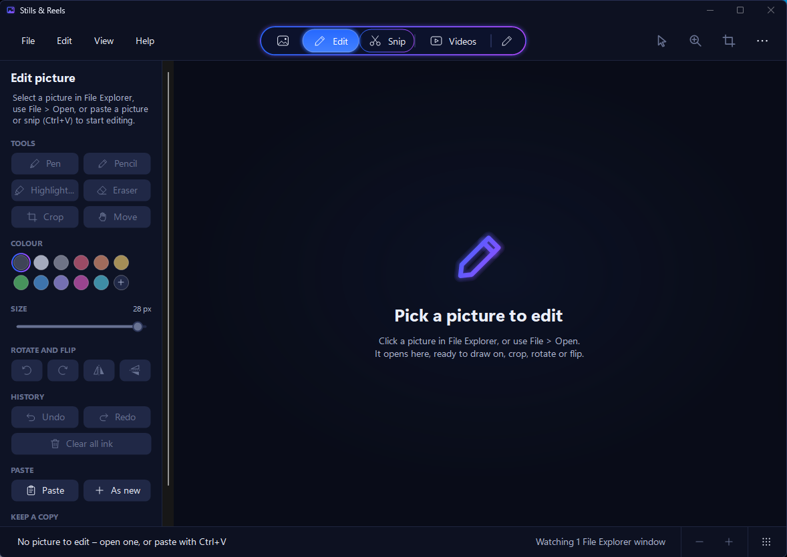

<div align="center">



# Stills & Reels

**View, edit, snip and cut your pictures and videos, all in one fast little app. Click a file in File Explorer and it's already open and ready to work on.**


[](LICENSE)

[What it is](#what-it-is) · [Hobby project](#a-hobby-project) · [Features](#features) · [Download and run](#download-and-run) · [User guide](docs/GUIDE.md) · [Privacy](#your-files-stay-yours) · [Build from source](#building-from-source) · [Licence](#licence) · [Credits](#credits-and-licences)

</div>

---

## What it is

**Stills & Reels** is a picture viewer, picture editor, video player and video editor in one lightweight Windows app. It started as a quick viewer for whatever you click in File Explorer and grew into a full editor, with everything happening inside the app.

- **One file, nothing to install.** Unzip it and double-click `StillsAndReels.exe`. It runs on any Windows 10 or 11 PC.
- **Follows File Explorer.** Click a picture or video in any File Explorer window and it's already showing.
- **Four modes, one bar.** Switch between **Pictures**, picture **Edit**, **Videos** and video **Edit** from the bar at the top.
- **Your originals are safe.** Edits are only ever saved as new files.
- **Completely offline.** The app has no network code. Nothing is uploaded and nothing is sent anywhere.

It used to be called **Picture Preview**. Version 2.2 is the first under the new name, and your settings carry over automatically.

## A hobby project

> [!NOTE]
> Stills & Reels is a **hobby project**, made in spare time by one person with the help of an AI coding assistant. It's shared for free in the hope that it's useful, but please go in with your eyes open:
>
> - **There will be bugs.** It has been tested, but not on every PC, screen setup or file type. Keep backups of anything important (your originals are never changed, but projects and new files can be).
> - **Video quality can drop.** Every export and screen recording is re-compressed, so a video that goes through the editor won't look quite as sharp as the original, and quality drops a little more each time a video is exported again. For the best results, export once from your original files at the highest quality you need.
> - **It isn't a professional tool.** It's built for quick, everyday edits, not for work where every frame matters.
>
> **It's offered as it is.** It's finished as far as its author is concerned: there's no support, and no bug fixes or updates are planned. If you'd like to take it further, the licence lets you fork it and make it your own.

## Features

### Pictures
- Instant preview of the picture selected in File Explorer, following you as you click or arrow through a folder
- Zoom, fit to window, actual size, and a pixel grid when you zoom right in
- Photos taken sideways are shown the right way up

### Edit picture
- Pen, pencil, highlighter and eraser in any colour and size
- Crop, rotate and flip, with full undo and redo
- **Paste as a layer**, like paint.net: paste from the clipboard or a snip, then drag and resize it before placing it
- Save a copy as PNG, JPG, BMP, GIF or TIFF

### Snip
- Grab any part of your screen as a **rectangle** or a **freeform** shape, or snip from the picture you have open
- Every snip goes to your clipboard straight away
- Draw on it, save it, or **paste it into the editor** in one click
- The main window stays on screen while you snip, so you can capture the app itself

### Videos
- A player that follows whichever video you select in File Explorer
- Keyboard controls you already know: Space or K, J and L, arrow keys, M to mute, F for full screen

### Video snip
- Record a whole screen or an area you drag out
- Choose the frame rate, whether the mouse pointer shows, and an optional microphone
- A small on-screen bar to pause, resume and stop, kept out of the recording itself
- Save it as MP4 or send it straight to the video editor

### Video editor
- A **multitrack timeline** with a media bin, in the style of CapCut
- **Transitions, filters and effects**, dragged onto clips
- **Keyframes** to animate position, size, rotation and opacity
- **Text** titles, **audio tracks** and **speed changes**
- Split, trim, duplicate, copy and paste, with undo
- Save projects as `.srproj` (older `.ppvproj` projects still open)
- **Export** to MP4 (H.264 + AAC) from 480p to 4K at 24 to 60 fps, or to MP3 for sound only

<div align="center">

**[Read the full user guide →](docs/GUIDE.md)**

</div>

## Download and run

1. Download **`StillsAndReels.zip`** from the [Releases](../../releases) page.
2. Right-click it and choose **Extract All…**
3. Double-click **`StillsAndReels.exe`**.

The first time you run it, Windows may show **"Windows protected your PC"**, because the app isn't code-signed. Click **More info**, then **Run anyway**. Windows only asks once.

That's all. There's no installer, no account and nothing else to download. The .NET Framework 4.8 it runs on is already part of Windows 10 and 11.

### The video engine

Video playback, editing, recording and export run through **FFmpeg 7.1**, which is built into the exe. The first time you use a video feature, the app unpacks it to `%LOCALAPPDATA%\StillsAndReels\Engine` (about 85 MB, a few seconds, once only) and checks it against a SHA-256 checksum. The app runs it quietly in the background; you never run it yourself. To remove it, delete that folder.

## Your files stay yours

- **Originals are never changed or overwritten.** Edits, snips, recordings and exports are only saved as new files.
- **Pictures are read from a temporary copy**, which is deleted as soon as you move to another picture.
- **The video editor's media cache** keeps copies of videos you view (you can turn this off) and files you import. They're deleted when you remove them from Media or close the app.
- **Nothing touches the network.** The app has no network code, and FFmpeg is only ever given files on your PC and, when you record, your screen and the microphone you choose.

## Known limitations

- Sound playing on your computer isn't recorded by Video snip, only a microphone.
- There are no automatic captions.
- Stabilise applies in playback and export only.
- There are no masks or blend modes yet.

## Building from source

Stills & Reels is written in C# with Windows Forms, about 17,000 lines, and targets the .NET Framework 4.8. It's built on Linux with Mono and produces a single Windows exe.

**You need:** `mono-mcs` (with the 4.8 reference assemblies) and `mingw-w64` (for `windres`).

1. Get the FFmpeg 7.1 Windows "essentials" build (GPLv3, by gyan.dev; the one used is from the imageio-ffmpeg 0.6.0 wheel), put it at `engine/ffmpeg.exe`, then compress it:
   ```bash
   gzip -9 -k engine/ffmpeg.exe      # gives engine/ffmpeg.exe.gz
   ```
   The app checks the unpacked engine against the SHA-256 in `src/BuildInfo.cs`, so a different build needs that value updating.
2. Build:
   ```bash
   ./build.sh                        # gives build/StillsAndReels.exe
   ```

The FFmpeg engine isn't kept in this repository because of its size. See [BUILD NOTES.txt](BUILD%20NOTES.txt) for more.

### Tests

The tests load the built exe by reflection and run under Mono (with Xvfb for the window tests):

| Test | What it checks |
|---|---|
| `tests/logic.cs` | File types, EXIF rotation, the picture cache, editing, crop and rotate, saving in every format, and that originals are untouched |
| `tests/CloseTest.cs` | The app closes cleanly with each Snip window open |
| `tests/HideTest.cs` | New snip hides only the Snip window, keeps the main window visible, and brings the Snip window back (run with `picture` or `video`) |

### Where things are

| Path | What's in it |
|---|---|
| `src/MainForm.cs` | Main window, menus, the four modes, snips |
| `src/Snip.cs`, `src/VideoSnip.cs` | Picture snip and screen recording |
| `src/EditSession.cs`, `src/EditSidebar.cs`, `src/ImageCanvas.cs` | Picture editing, including the paste layer |
| `src/VideoView.cs`, `src/VideoPlayer.cs`, `src/FFmpeg.cs` | Video playback and the bundled FFmpeg |
| `src/VideoProject.cs` | The project model (`.srproj`, older `.ppvproj`) |
| `src/MediaLibrary.cs`, `src/Compositor.cs`, `src/EditorEngine.cs`, `src/Timeline.cs`, `src/EditorPanels.cs`, `src/VideoEditorView.cs`, `src/ExportDialog.cs` | The video editor |
| `src/ExplorerWatcher.cs` | Following the File Explorer selection |
| `tests/` | The automated tests |
| `docs/GUIDE.md` | The user guide |
| `READ ME.txt` | The read-me that ships with the app, including the full licence and credits text |

## What's new

**2.2:** the app is renamed from Picture Preview to Stills & Reels, settings carry over automatically, old engine and cache folders are tidied up, and projects save as `.srproj`. New snip now leaves the main window on screen so it can be captured.

See the [changelog](CHANGELOG.md) for everything.

## Made with AI

Stills & Reels was written with **[Anthropic's Claude](https://claude.ai/code)** as the coding assistant, working from the requests, reference designs and testing of the project's owner. No source code, icons or other assets were copied from any other project or product:

- Every icon is a simple line drawing made in code.
- The image effects use standard, published formulas rather than anyone's code: luma weights from ITU-R BT.709, YCbCr from ITU-R BT.601 (for chroma key), saturation and hue-rotation matrices in the style of the W3C Filter Effects specification, the common sepia matrix, and textbook box blur, unsharp mask and vignette techniques.

## Licence

Copyright © 2026 BigDaddy284.

Stills & Reels is free software: you can redistribute it and/or modify it under the terms of the **[GNU General Public License version 3](LICENSE)**, or (at your option) any later version, as published by the Free Software Foundation. This is the same licence as the FFmpeg engine it bundles.

In plain words: you can use, study, change and share Stills & Reels, and even sell it. But if you share or sell a version of it, changed or not, you must make its full source code available under the same GPLv3 licence, keep the copyright and licence notices, and pass on the same freedoms to everyone who gets it. Nobody can take this code, close it up and sell it as their own.

Stills & Reels comes **without any warranty**. See [LICENSE](LICENSE) for the full terms.

## Credits and licences

### FFmpeg (included)

Stills & Reels includes **[FFmpeg](https://ffmpeg.org) 7.1**, by the FFmpeg developers, in the Windows 64-bit "essentials" build compiled by **[Gyan Doshi](https://www.gyan.dev/ffmpeg/builds/)**, obtained unchanged from **[imageio-ffmpeg](https://github.com/imageio/imageio-ffmpeg) 0.6.0** (BSD 2-Clause).

- FFmpeg is licensed under the **[GNU General Public License v3](https://www.gnu.org/licenses/gpl-3.0.html)**. Its source is at [ffmpeg.org/releases/ffmpeg-7.1.tar.xz](https://ffmpeg.org/releases/ffmpeg-7.1.tar.xz), and the builder's page lists the exact version of every library compiled in.
- It runs as a separate program, controlled through command-line options and data pipes, and isn't linked into the app's own code.
- The build includes libraries such as x264, x265, LAME, libvpx, libaom, Opus and many more, each under its own licence. The full list, the imageio-ffmpeg licence notice and the SHA-256 checksum are in [READ ME.txt](READ%20ME.txt).
- Some formats (for example H.264, H.265, AAC and MP3 in some countries) may be covered by patents. These licences are copyright licences only.

### Part of Windows (not included)

The app is built on the Microsoft .NET Framework 4.8, Windows Forms and GDI+, and uses standard Windows libraries and the system fonts (such as Segoe UI) already on your PC.

### Build and test tools (not included)

Mono's C# compiler and reference assemblies (MIT), GNU windres and the C preprocessor from MinGW-w64 / GNU Binutils (GPL v3), and, for tests only, FFmpeg for Linux, Xvfb, xdotool, ImageMagick and Python.

### Inspiration only

The layout and workflows were modelled on familiar apps: **CapCut** (ByteDance) for the video editor, **paint.net** (dotPDN LLC) for pasting as a layer, and the **Windows Snipping Tool** (Microsoft) for snipping. Stills & Reels contains none of their code, artwork, icons or names in its interface. These names are trademarks of their owners, and Stills & Reels isn't affiliated with or endorsed by them.

---

<div align="center">

Stills & Reels is provided "as is", without warranty of any kind. This summary isn't legal advice: the licence texts linked above are what apply.

</div>
